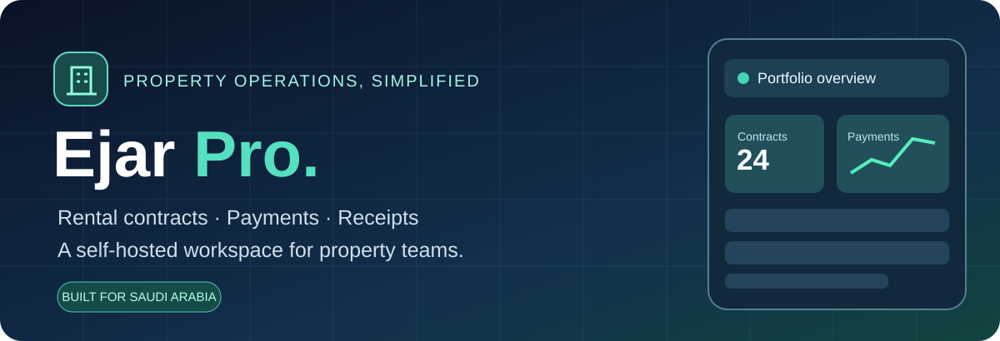
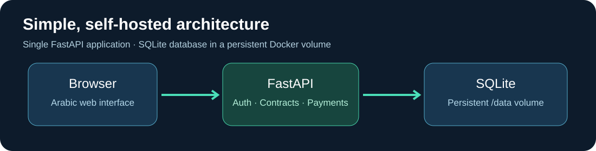

<div align="center">



# إيجار Pro · Ejar Pro

**منصة عربية ذاتية الاستضافة لتنظيم العقارات، العقود، الدفعات، والإيصالات.**

**Self-hosted rental and property operations for Saudi-focused workflows.**

[](https://github.com/ThamerLab/ejar-pro/actions/workflows/ci.yml)


</div>

> [!WARNING]
> هذا المشروع يتعامل مع بيانات مستأجرين ودفعات مالية. **لا تنشره للإنترنت مباشرة** قبل مراجعة الأمان وتطبيق HTTPS وحماية CSRF وضبط الصلاحيات. نجحت فحوصات صياغة الكود فقط إن نجحت CI؛ هذا ليس اختبار اختراق أو إثباتًا لجاهزية الإنتاج.

## ✨ ما الذي يقدمه؟

- متابعة العقارات والوحدات والمستأجرين والعقود.
- تسجيل الدفعات الجزئية وإصدار أرقام إيصالات.
- متابعة المتأخرات وقوالب التذكير والتصعيد.
- لوحات عربية للعرض والتحكم، وصلاحيات حسابات أساسية.
- دعم إعدادات Telegram وقوالب التواصل.
- SQLite محلية مستمرة في Volume داخل Docker.

**تنبيه:** رقم عقد «إيجار» حقل مرجعي داخل التطبيق؛ لا يُفهم منه وجود تكامل رسمي مباشر مع منصة إيجار الحكومية.



*رسم توضيحي للبنية وليس لقطة شاشة من التطبيق.*

## 🚀 التشغيل السريع

### Docker Compose

يتطلب Docker وDocker Compose. **انسخ ملف القيم أولًا**، ثم غيّر جميع الأسرار:

```bash
git clone https://github.com/ThamerLab/ejar-pro.git
cd ejar-pro
cp env.example .env
python3 -c "import secrets; print(secrets.token_urlsafe(48))"
# ضع ناتج الأمر في SECRET_KEY وعدّل ADMIN_PASSWORD في .env
docker compose up -d --build
docker compose ps
```

افتراضيًا ستكون الواجهة على `http://127.0.0.1:9090` من **خادم Docker نفسه**. للوصول من جهاز آخر على LAN، اضبط `BIND_IP` على عنوان LAN للخادم مع قواعد جدار ناري مناسبة. استخدم Reverse Proxy مع HTTPS إذا احتجت وصولًا من خارج الخادم، ولا تعتمد على HTTP العادي عبر شبكة غير موثوقة.

**مهم عند التحديث:** إعداد `ADMIN_PASSWORD` يستخدم **فقط لإنشاء الحساب الإداري عند أول تهيئة**. تغييره في `.env` لا يغيّر كلمة مرور حساب موجود في قاعدة البيانات.

### Portainer

اختر **Stacks → Add stack → Repository**، وضع الرابط:

`https://github.com/ThamerLab/ejar-pro`

حدّد `docker-compose.yml` وأضف `SECRET_KEY` العشوائي و`ADMIN_USERNAME` و`ADMIN_PASSWORD`، وبقية متغيرات المنفذ والشبكة عند الحاجة. تحقق أن نسخة Portainer تدعم بناء صورة المشروع من Git، وأن مسار البناء متاح. بعدها افحص حالة الحاوية والسجلات. التفاصيل في [DEPLOYMENT.md](DEPLOYMENT.md).

## ⚙️ الإعدادات

| المتغير | الوصف | الإعداد |
|---|---|---|
| `SECRET_KEY` | توقيع جلسات المستخدمين | مطلوب، عشوائي، 32 حرفًا أو أكثر |
| `ADMIN_USERNAME` | اسم أول مدير | `admin` |
| `ADMIN_PASSWORD` | كلمة مرور أول مدير | مطلوبة، 14 حرفًا أو أكثر |
| `DB_PATH` | مكان قاعدة البيانات داخل الحاوية | `/data/ejar.db` |
| `BIND_IP` | عنوان الاستماع على مضيف Docker | `127.0.0.1` |
| `APP_PORT` | المنفذ المنشور | `9090` |
| `SECURE_COOKIES` | Cookies مقيدة بـHTTPS | `false` محليًا، و`true` خلف HTTPS |

لا تضع كلمة المرور الحقيقية أو المفتاح السري في GitHub. يحتوي المستودع على `.gitignore` لاستبعاد `.env` وقواعد بيانات SQLite المحلية.

## 💾 النسخ الاحتياطي

البيانات محفوظة في Docker volume مربوط بمسار `/data`. **خذ نسخة احتياطية قبل تحديث الإصدار**، واحتفظ بمفتاح `SECRET_KEY` وإعدادات النشر منفصلين. لنسخ قاعدة SQLite بصورة متسقة، استخدم SQLite backup API أو أوقف التطبيق مؤقتًا قبل نسخ ملف `ejar.db`؛ النسخ الخام أثناء الكتابة قد ينتج ملفًا غير متسق. اختبر الاسترجاع على نسخة مستقلة قبل استبدال البيانات الحية.

## 🗂️ هيكل المشروع

```text
backend/            FastAPI · SQLAlchemy · Auth · Seed
frontend/           واجهة عربية · صفحات تسجيل الدخول والتطبيق
docs/images/        رسومات README توضيحية
Dockerfile          بناء صورة Python
docker-compose.yml  نشر التطبيق وSQLite Volume
env.example         نموذج متغيرات البيئة
DEPLOYMENT.md       خطوات النشر والصيانة
ARCHITECTURE.md     نظرة على المكونات
DATABASE.md         توثيق الجداول
.github/workflows/  الفحوصات التلقائية
```

## 🛡️ حدود الأمان

يستخدم التطبيق جلسات موقّعة وكلمات مرور مجزأة، لكن مراجعة الكود الأولية أظهرت أن **حماية CSRF وقيود الصلاحيات التفصيلية وتدقيق التزامن المالي** تحتاج اختبارات ومراجعة إضافية قبل الاعتماد الإنتاجي. لذلك يُفضّل تشغيله على شبكة خاصة، وعدم تخزين بيانات حساسة حقيقية قبل التأكد من سياسات الحفظ والوصول والنسخ الاحتياطي. المعلومات الموجودة هنا لا تعني اجتياز تدقيق أمني مستقل.

## 🤝 المساهمة

يمكن فتح Issues وPull Requests مع خطوات إعادة المشكلة، ومن دون إرفاق هويات المستأجرين أو معلومات عقودهم أو بيانات الدفع. أجرِ الاختبارات المتاحة وراجع تأثير أي تعديل على قاعدة البيانات قبل رفعه.

Built and maintained by [ThamerLab](https://github.com/ThamerLab).
